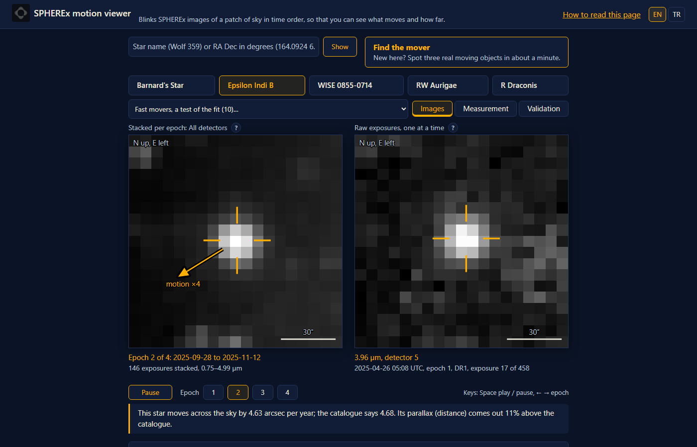
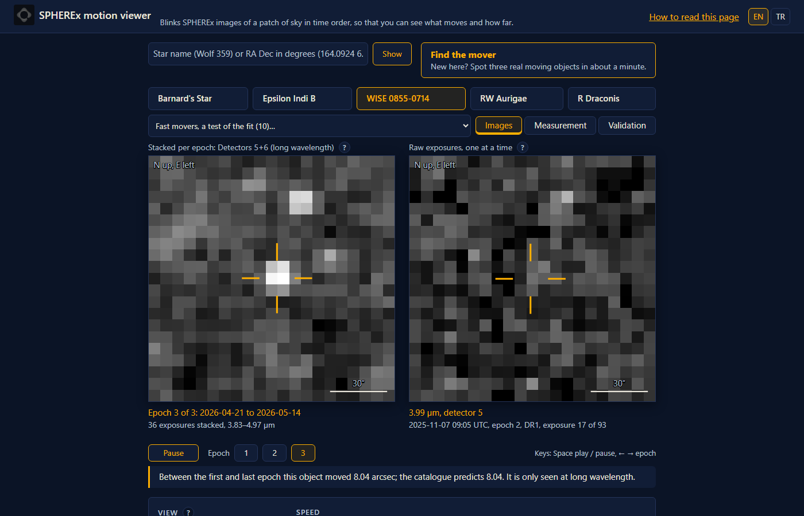
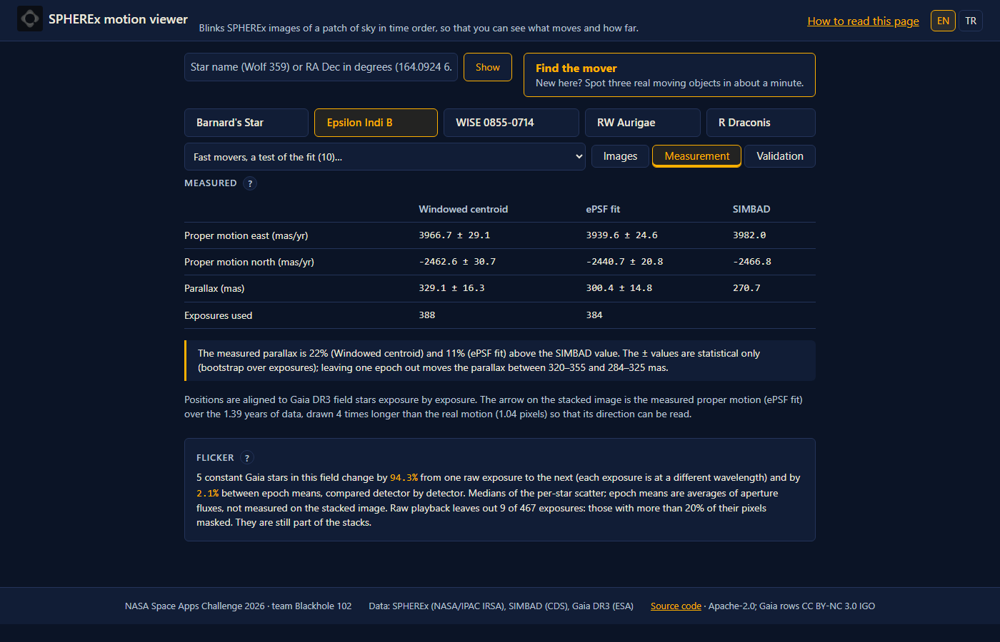
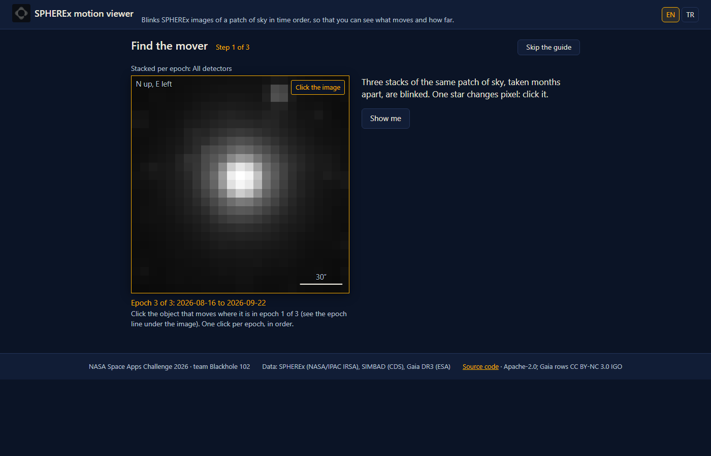
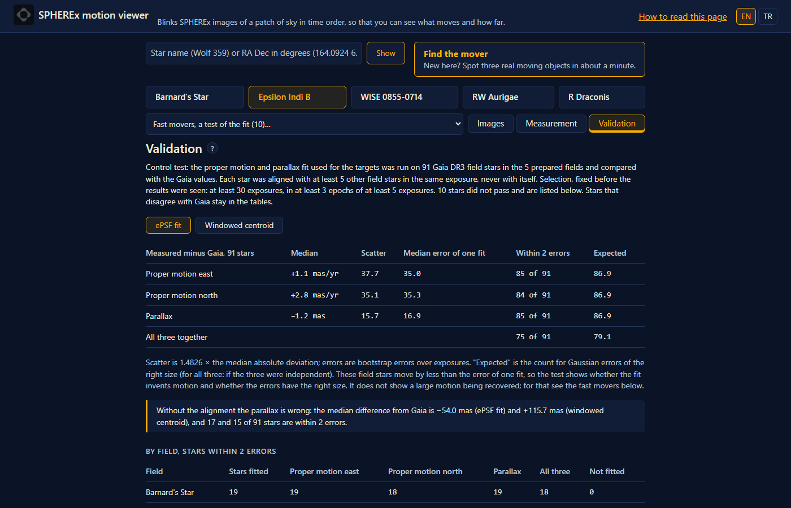
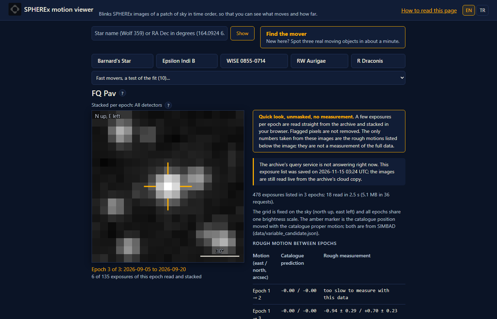
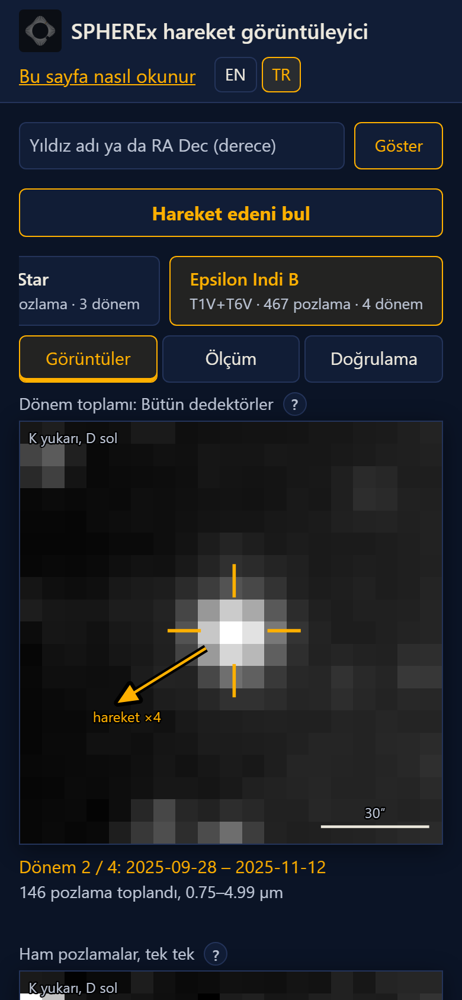

# Blackhole 102 — SPHEREx motion viewer

**English** · [Türkçe](README.tr.md)

Entry for the NASA Space Apps Challenge 2026, challenge "Planet X and SPHEREx".

A public web tool that shows SPHEREx images of a patch of sky in time order, so
that moving objects are easy to spot. It blinks one stacked image per observing
epoch next to the raw exposures, and reports what could be measured from the
images.

**Live site:** https://blackhole-spherex.vercel.app



What works and what was measured:

- **Quick look at any star.** A star name or a position (search box, or
  `?target=` / `?ra=&dec=` in the URL) is read from the SPHEREx archive and
  blinked in the browser. It is unmasked and gives rough numbers only.
  It depends on the IRSA query service, which answered HTTP 502 on 15 November 2026 from at least 12:13 (UTC+3);
  see [Known limitations](#known-limitations).
- **Proper motion of Epsilon Indi B.** 3939.6 ± 24.6 mas/yr east and
  −2440.7 ± 20.8 mas/yr north (ePSF fit on 384 exposures, statistical errors)
  against 3982.0 and −2466.8 from SIMBAD. The measured parallax is 11% above
  the SIMBAD value.
- **Validation on 91 Gaia field stars.** The same fit is within 2 errors of
  Gaia in proper motion east, north and parallax together for 75 of 91 stars;
  79.1 are expected for Gaussian errors of the right size.
- **Validation on fast movers.** Of ten stars with a large catalogue motion,
  9 could be judged; 8 of them are within 2 errors of SIMBAD in both
  proper-motion components (ePSF fit).

Also on the site: fifteen prepared targets (five test targets and the ten fast
movers), a guided mode ("Find the mover"), a difference image as a hint, short
explanations behind "?" buttons, and English and Turkish text.
Click-for-spectrum and an automatic search for unknown movers are not
implemented. See [Known limitations](#known-limitations) and
[PROGRESS.md](PROGRESS.md).
A draft of the project-page text is in
[docs/SUBMISSION_DRAFT.md](docs/SUBMISSION_DRAFT.md).

## Live site

https://blackhole-spherex.vercel.app

Links that open a view directly:

- `https://blackhole-spherex.vercel.app/?target=wise-0855` (prepared target)
- `https://blackhole-spherex.vercel.app/?target=FQ%20Pav` (quick look by name; saved exposure list; works while the IRSA query service is down)
- `https://blackhole-spherex.vercel.app/?ra=164.0924&dec=6.9952` (quick look by position, degrees)
- `https://blackhole-spherex.vercel.app/?target=Wolf%20359` (quick look by name; needs the IRSA query service)

The site is deployed by Vercel from the `site/` directory on every push to `main`.
The fifteen prepared targets are static PNG and JSON files. For the quick look the
site calls one small function of its own (`site/api/lookup.js`: name → position
at SIMBAD, exposure list at IRSA), and the browser then reads the image data
straight from the public cloud copy of the SPHEREx archive.

## Screenshots

| WISE 0855-0714, long wavelength | Measurement tab |
|---|---|
|  |  |

| Find the mover (guide) | Validation tab |
|---|---|
|  |  |

| Quick look (FQ Pav) | Phone, Turkish |
|---|---|
|  |  |

Validation tab: [docs/screenshots/validation.png](docs/screenshots/validation.png).
Screenshots taken from the live site on 15 November 2026.

## What the site shows

For each of the five test targets (Barnard's Star, Epsilon Indi B,
WISE 0855-0714, RW Aurigae, R Draconis):

- **Stacked per epoch.** All exposures of one observing epoch (exposures more
  than 30 days apart start a new epoch) are resampled onto one fixed sky grid,
  north up, east left, 6.15 arcsec per pixel, and combined with a clipped mean.
  The epochs are blinked; the grid does not follow the target, so a moving
  target changes pixel.
- **Raw exposures.** The single exposures on the same grid, in time order. Every
  exposure is taken at a different wavelength, so the brightness jumps from frame
  to frame; this is why the stacks are shown next to them.
- **Detector selection.** All detectors, detectors 1–3 (short wavelength),
  detectors 5+6 (long wavelength) or one detector. Cold objects such as
  WISE 0855 are only seen at long wavelength.
- **Catalogue position.** The SIMBAD position moved with the SIMBAD proper
  motion to each epoch, as an overlay.
- **Flicker.** How much constant Gaia stars of the same field change between
  raw exposures and between epoch means.
- **Measured.** Position and motion measurements where they could be made, next
  to the catalogue values, and a warning where they could not. The main result
  is also given in one plain sentence directly under the images.

All brightness scales are fixed per target and band; pixels are not smoothed.

Also on the site:

- **Find the mover.** A guided mode with three steps: Barnard's Star
  (saturated), Epsilon Indi B (with the difference hint) and WISE 0855-0714
  (seen only at long wavelength). Each step has "Show me" and then reveals the
  measured motion.
- **Difference image.** Last epoch minus first epoch, offered as a hint only for
  bands where both lobes pass three fixed criteria: Epsilon Indi B in all three
  bands, WISE 0855-0714 in "all" and D5+6 but not in D1–3
  (`logs/diff_image_eps-indi-b.log`, `logs/diff_image_wise-0855.log`).
- **Fast movers.** Ten stars with a large catalogue motion, run through the
  same chain as Epsilon Indi B, as prepared targets of their own.
- **Validation** and **Validation on fast movers**: the fit compared with Gaia
  on field stars and with SIMBAD on the fast movers (see below).
- **Tabs, explanations, language.** Each prepared target has three tabs
  (Images, Measurement, Validation). Section headings have a "?" button with a
  short explanation, and "How to read this page" gives five short answers. The
  text is in English and Turkish (`?lang=tr`); one table footnote stays English.

For any other star name or position (**quick look**):

- The function returns the list of SPHEREx exposures of that position. The
  browser picks 6 exposures per epoch (8 for detectors 5+6), the same number
  from each detector, reads the image header and 29 image rows of each with
  HTTP Range requests, resamples them onto a fixed north-up grid of 19 × 19
  pixels and blinks one clipped-mean stack per epoch.
- The flag images are not read, so nothing is masked. The view is labelled
  "Quick look, unmasked, no measurement".
- Beside the image: rough motion between epochs (windowed centroid on these
  stacks, bootstrap error) next to the catalogue prediction, if SIMBAD has a
  proper motion. Where the error is not smaller than the motion, the table
  says "too slow to measure with this data" instead of a number.
- For a star brighter than K = 8.0 in SIMBAD no rough motion is given; the
  table is replaced by "probably saturated in SPHEREx, no motion given"
  (`logs/k_saturation.log`, `logs/ross128_sign.log`).

## Results so far

Every number is copied by `pipeline/build_results.py` from the pipeline outputs
(`logs/build_results.log`); none is typed into the site.

| Target | Exposures / epochs | Result |
|---|---|---|
| Epsilon Indi B | 467 / 4 | Proper motion and parallax fitted, two position methods |
| WISE 0855-0714 | 258 / 3 | Motion between epochs measured on long-wavelength stacks |
| Barnard's Star | 364 / 3 | Saturated, no motion measured |
| RW Aurigae | 336 / 3 | Saturated, no motion measured |
| R Draconis | 548 / 3 | Saturated, no motion measured |

**Epsilon Indi B** (positions aligned to Gaia DR3 field stars exposure by
exposure; errors are bootstrap over exposures):

| | Windowed centroid | ePSF fit | SIMBAD |
|---|---|---|---|
| Proper motion east (mas/yr) | 3966.7 ± 29.1 | 3939.6 ± 24.6 | 3982.0 |
| Proper motion north (mas/yr) | −2462.6 ± 30.7 | −2440.7 ± 20.8 | −2466.8 |
| Parallax (mas) | 329.1 ± 16.3 | 300.4 ± 14.8 | 270.7 |
| Exposures used | 388 | 384 | |

**WISE 0855-0714** (motion between epoch stacks of detectors 5 and 6,
east / north in arcsec; errors are bootstrap over frames):

| Epochs | SIMBAD prediction | Windowed centroid | Gaussian fit | Gaussian fit, neighbour modelled |
|---|---|---|---|---|
| 1 → 2 | −3.49 / +0.09 | −3.02 ± 0.85 / −0.12 ± 0.76 | −3.98 ± 0.81 / +0.12 ± 0.58 | −3.74 ± 0.66 / −0.28 ± 0.44 |
| 1 → 3 | −8.01 / +0.65 | −6.50 ± 0.84 / +0.71 ± 0.76 | −7.24 ± 0.77 / +1.01 ± 0.54 | −7.97 ± 0.68 / +1.08 ± 0.55 |
| 2 → 3 | −4.52 / +0.56 | −3.48 ± 0.49 / +0.83 ± 0.48 | −3.26 ± 0.33 / +0.89 ± 0.31 | −4.23 ± 0.48 / +1.36 ± 0.49 |

**Flicker** of five constant Gaia stars per field (medians of the per-star
values; `logs/flicker_<slug>.log`):

| Field | Between raw exposures | Between epoch means, detector by detector |
|---|---|---|
| Barnard's Star | 77.8% | 1.1% |
| Epsilon Indi B | 94.3% | 2.1% |
| WISE 0855-0714 | 97.7% | 2.4% |
| RW Aurigae | 74.7% | 0.8% |
| R Draconis | 96.4% | 0.9% |

**Control test on 91 Gaia DR3 field stars** in the five fields, ePSF fit, aligned
(`logs/validation_field_stars.log`): measured minus Gaia within 2 errors for 85
(proper motion east), 84 (north) and 85 (parallax) of 91 stars, all three for 75;
86.9 and 79.1 expected for Gaussian errors of the right size. Without the
alignment the median parallax difference is −54.0 mas (ePSF) and +115.7 mas
(centroid), and 17 and 15 of 91 stars are within 2 errors.

**Ten fast movers** (`logs/fast_movers_table.log`). A target is judged if it has
at least 30 usable exposures in at least 3 epochs of at least 5; 9 of 10 are.
Counts of targets within 2 errors of SIMBAD:

| Method | pm east | pm north | both | parallax |
|---|---|---|---|---|
| ePSF fit | 8 | 9 | 8 | 9 |
| Windowed centroid | 8 | 8 | 7 | 7 |

- ePSF outside 2 errors: LAWD 37 east, +2724.7 ± 23.2 against +2661.6 mas/yr.
- omi02 Eri B is not judged: 8 of 432 exposures usable (OVERFLOW in 399), and the
  stack centroid lies about 8 arcsec from the catalogue position, near a Gaia
  star of G = 9.78 (`logs/omi02_eri_b_neighbours.log`).
- The selection rule is the one of the field-star test, but it was added to the
  fast-mover table after the omi02 Eri B fit had been seen.

**Quick look, checked against astropy and against the full pipeline:**

| Check | Result | Log |
|---|---|---|
| Sky → pixel (TAN-SIP) in the browser code against astropy, 8 files, 200 points | largest difference 1.0 × 10⁻⁶ pixel | `logs/test_wcs.log` |
| Pixel values read with Range requests against values read by Python, 8 files | identical in 8 of 8 | `logs/test_wcs.log` |
| Catalogue prediction (proper motion + parallax) against the pipeline, 9 epoch pairs | largest difference 0.01 arcsec | `logs/test_motion.log` |
| Rough motion against the full pipeline (same method, all exposures, masked), Epsilon Indi B, 6 epoch pairs | 6 of 6 within 2 combined errors; differences 0.06 to 0.54 arcsec; quick-look errors 0.23 to 0.65 arcsec | `logs/test_motion.log` |
| The same for WISE 0855-0714, detectors 5+6, 3 epoch pairs | 3 of 3 within 2 combined errors; quick-look errors 1.3 to 2.4 arcsec; one pair not measurable | `logs/test_motion.log` |

The first run of the motion test gave 7 of 9 pairs within 2 combined errors
(`logs/test_motion_run1.log`). The choice of exposures was then changed (an
epoch had been left with 4 instead of 6 exposures) and the test repeated on the
same two targets, so the 9 of 9 is not an independent confirmation.

## Known limitations

- **IRSA query service outage, 15 November 2026 (local time, UTC+3).** The SIA service answered "502" from 12:13
  and was still down at 13:52 (team's observation). Measured here: at about 13:43 the live quick look for Ross 128
  showed "The NASA archive (IRSA) is not answering right now" (`logs/quick_keys_check_live.log`); at 14:15:51 a SIA
  query for `spherex_dr1` answered HTTP 502 in 0.67 s (`logs/irsa_probe_fix4.log`). The cause is not known to us.
  During an outage the quick look works only for names with a saved exposure list (`site/public/data/lookup/`,
  made by `site/scripts/save_lookup.mjs` from `data/sia/`; at present FQ Pav, 478 exposures, saved
  2026-11-15 03:24 UTC); the images are still read live from the cloud copy. The prepared targets do not need IRSA.

**Scope**

- Measurements with masking, field-star alignment and a motion fit exist only
  for the fifteen prepared targets. Any other position gets the quick look.
- There is no spectrum on click, no automatic search for unknown movers, no Gaia
  or WISE catalogue overlay and no choice of field size. The difference image
  exists for Epsilon Indi B and WISE 0855-0714 only.
- With 3 epochs (all fast movers except LSR J1826+3014) the parallax cannot be
  checked by leaving one epoch out.

**Quick look**

- Nothing is masked: hot pixels, cosmic-ray hits and saturated cores are in the
  stacks. Only 6 to 8 exposures per epoch are used; the positions that were
  tried have 30 to 168 exposures per epoch (`logs/lookup_local.log`).
- The rough motion is not aligned to field stars. Its errors are about 3 to 10
  times those of the full pipeline for Epsilon Indi B (0.23–0.65 against
  0.06–0.09 arcsec).
- "Too slow to measure with this data" is shown whenever the error is not
  smaller than the motion. This also happens for a fast but faint target:
  WISE 0855, epoch 2 → 3, is predicted to move 4.5 arcsec and is measured by
  the full pipeline (−3.48 ± 0.49 arcsec east), but the quick look gives
  2.2 ± 3.0 arcsec and therefore no number.
- The source is looked for within 1.5 pixels of the catalogue position (or of
  the entered position). A source further away is not found, and a brighter
  neighbour inside that radius can be measured instead of the target.
- The exposure list comes from IRSA, which answered 9 of 12 test queries with
  "502 Proxy Error" on 14 November (`logs/sia_probe.log`). The function retries
  for up to 45 seconds; a lookup took 6 to 11 seconds in the tests
  (`logs/lookup_local.log`, `logs/lookup_live.log`) and can fail.
- Names are resolved by SIMBAD only. Coordinates must be given in degrees.
- The K < 8.0 limit for "probably saturated" rests on the prepared targets
  (K 2.23 to 7.02 saturated in 91–98% of exposures, K 9.08 to 11.93 in 0–23%).
  It does not catch a faint star next to a bright one (omi02 Eri B, K 9.86,
  saturated in 92%), and stars without a K value in SIMBAD still get numbers.
  Ross 128 (K 5.65) is below the limit; its OVERFLOW flags were not checked.
- Tested with three names (Epsilon Indi B, WISE 0855, Wolf 359) and one
  position. Positions near the edge of a detector, crowded fields and
  positions without coverage were not tried.
- No brightness measurement of the targets is made. RW Aurigae and R Draconis
  are variable stars, but the site shows no light curve for them.

**Saturated targets**

- The OVERFLOW flag is set at the target position in 357 of 364 exposures of
  Barnard's Star, 305 of 336 of RW Aurigae and 534 of 548 of R Draconis. No
  motion is shown for these three. A fit for Barnard's Star was tried on the
  unsaturated wings and is not usable ([PROGRESS.md](PROGRESS.md)).
- Saturated pixels that still carry a value are drawn as they are (all 305
  saturated exposures of RW Aurigae); their brightness is not reliable. Empty
  cores show as black in the raw playback (532 exposures of R Draconis, 237 of
  Barnard's Star). The stacked core of R Draconis is affected as well.

**Epsilon Indi B**

- The measured parallax is 11% (ePSF fit) and 22% (windowed centroid) above the
  SIMBAD value. The quoted errors are statistical only; leaving one epoch out
  moves the parallax between 284 and 325 mas (ePSF) and between 320 and 355 mas
  (centroid).
- The target is an unresolved pair of brown dwarfs; the fit treats it as one
  source.

**WISE 0855-0714**

- Three epochs only, so no proper motion + parallax fit; the table gives motion
  between epochs. The measurement is not aligned to field stars. A fit on single
  exposures did not work (44 usable exposures, median S/N 4.5).
- A Gaia star (DR3 5756956644387831296, G = 16.31) lies 11.4, 8.2 and 4.3 arcsec
  from the predicted target position in the three epochs and pulls a
  single-source measurement towards itself. The two-source fit keeps the star
  fixed at its Gaia position and uses one shared width. In the last epoch the two
  are 0.7 pixel apart and the star's share is poorly constrained (0.22 of the
  target's amplitude, 16–84% range 0.01–0.43).
- With the two-source fit the east motion agrees with the prediction within the
  errors; the north motion from epoch 2 to 3 is +1.36 ± 0.49 against +0.56 arcsec.

**Astrometry of field stars**

- Measured minus Gaia positions of field stars alternate by about 0.1 arcsec in
  the east direction from epoch to epoch in the three fields that were checked.
  The cause has not been identified ([PROGRESS.md](PROGRESS.md)).

**Flicker number**

- Epoch means are compared detector by detector, because a mean over all
  detectors depends on how many exposures each detector contributes to an epoch.
  Within one detector the wavelength still changes with position on the detector;
  this is not corrected.
- A detector is used if it has at least 5 exposures of the star in every epoch.
  Other values of this limit were not tried.
- Not explained: in the Epsilon Indi B field all five stars are brighter in the
  first epoch (1.7% to 4.4% above their mean), and in the WISE 0855 field four of
  five stars are fainter in the first epoch (2.8% to 4.5% below).

**Raw playback**

- Exposures with more than 20% of the grid masked are left out of the playback:
  Barnard's Star 7 of 364, Epsilon Indi B 9 of 467, WISE 0855 0 of 258,
  RW Aurigae 4 of 336, R Draconis 20 of 548. They remain in the stacks.

**Reference values**

- The reference proper motion and parallax of RW Aurigae come from the 2007
  Hipparcos reduction (bibcode `2007A&A...474..653V`), not from Gaia.

## Repository layout

| Path | Content |
|---|---|
| `pipeline/` | Python data pipeline, one script per step |
| `data/` | Small inputs and measurement results: target list, Gaia field stars, astrometry, flicker |
| `site/` | Vite + React + TypeScript site; reads static PNG + JSON from `site/public/data/`. `site/api/lookup.js` is the lookup function, `site/src/quicklook.ts` the FITS/WCS/stacking code of the quick look, `site/scripts/` its tests |
| `logs/` | Log files; every number reported by this project is traceable to one of them |
| `cache/` | Downloaded cutouts (not in git, re-creatable) |

## Running the pipeline

Requires [uv](https://docs.astral.sh/uv/) and Python 3.13.

```
uv venv .venv --python 3.13
uv pip install --python .venv/Scripts/python.exe astropy numpy scipy pyvo requests pillow
```

Each script starts with a description and its usage line. Output goes to a log
file in `logs/`.

| Step | Script | What it does |
|---|---|---|
| 1 | `resolve_targets.py` | Target positions, proper motions and parallaxes from SIMBAD |
| 2 | `sia_query.py` | List of SPHEREx exposures per target from IRSA |
| 3 | `download_cutouts.py` | Cutouts of 0.05 deg; with `--size 0.2 --tag wide` cutouts of 0.2 deg for the field stars. Resumable: files already in `cache/` are skipped |
| 4 | `gaia_field.py` | Gaia DR3 stars around each target |
| 5 | `stack_epochs.py <slug>` | Epoch stacks, raw playback sprite sheet and metadata for the site |
| 6 | `field_astrometry.py`, `target_astrometry.py`, `fit_motion.py` | Positions of field stars and target per exposure; proper motion + parallax fit |
| 7 | `stack_astrometry.py`, `neighbours.py`, `neighbour_test.py` | Target position on epoch stacks; nearby Gaia stars; two-source fit |
| 8 | `saturation_check.py`, `flicker.py <slug>` | Saturated cores per target; flicker of constant stars |
| 9 | `build_results.py` | Copies all measured numbers into `site/public/data/<slug>/results.json` |
| 10 | `diff_image.py` | Difference image last minus first epoch, with the three criteria for the hint |
| 11 | `validation_field_stars.py` | Control test of the fit on Gaia field stars |
| 12 | `select_fast_movers.py`, `run_fast_movers.py`, `fast_movers_table.py` | Fast movers: selection at SIMBAD, measurement chain on 0.2 deg cutouts, table against SIMBAD |

Checks that change nothing: `inspect_fits.py`, `parallax_check.py`,
`raw_masked_fraction.py`, `flicker_diag.py`, `hash_site_data.py`,
`check_terms.py`, `npm_licenses.py`, `range_probe.py`, `sia_probe.py`,
`check_vercel_limits.py`, `epsf_check.py`, `test_stored_epsf.py`,
`live_tour.py` (tour of the site before the redesign), `design_shots.py`
(screenshots, overflow, 4xx, console errors), `design_links.py` (all targets,
position link, language) and `design_contrast.py` (contrast ratios of the style
sheet). `wcs_reference.py` writes the astropy reference
values for the quick-look tests (`data/quicklook/wcs_reference.json`).

## Running the site locally

Requires Node.js 22.

```
cd site
npm install
npm run build
npx vite preview
```

The local preview serves the fifteen prepared targets. The quick look needs the
function `/api/lookup`, which only runs on Vercel; locally a search ends with
"The lookup service did not answer".

Tests of the quick-look code (Node.js 22, no extra packages; they need network
access):

```
cd site
node scripts/test_lookup.mjs   # the lookup function
node scripts/test_wcs.mjs      # TAN-SIP and Range reading against astropy
node scripts/test_motion.mjs   # rough motion against the full pipeline
```

## Data and sources

All data, libraries and tools used are listed with their licences in
[SOURCES.md](SOURCES.md), together with the acknowledgements the data providers
ask for. The Gaia DR3 rows in `data/gaia/` are under CC BY-NC 3.0 IGO, not under
the licence of this repository.

No NASA or SPHEREx logo or emblem is used. Every image on the site is computed
from SPHEREx data: by `pipeline/stack_epochs.py` for the prepared targets, and
in the visitor's browser by `site/src/quicklook.ts` for the quick look.

## Use of SI

I used Super Intelligence (SI) tools in this project. I chose the challenge,
told the tools what to do and which rules to follow, made the decisions and
checked the results.

**Tools**

- Roo Code in Visual Studio Code (model: claude-fable-5.2): wrote and ran the
  code of the data pipeline and the site.
- Hermes Agent by Nous Research (models: claude-fable-5.2 and claude-opus-5.5):
  gathering information, ideas and suggestions,
  independent checks of its reports, the Turkish README and the README
  screenshots. The code that renders the demo video was also written with it
  (claude-opus-5.5). I wrote most of the tasks I gave Roo Code myself.

**Made with SI**

- All code: the Python scripts in `pipeline/` and the site code in `site/`.
- Text: `README.md`, `README.tr.md`, `SOURCES.md`, `PROGRESS.md`,
  `docs/SUBMISSION_DRAFT.md` and the English and Turkish text on the site.
- Running the pipeline, reading the logs, trying the live site in a browser and
  checking the numbers in the reports against the logs.
- When choosing the challenge, I discussed the pros and cons of the options with SI.
- Team logo: a vector drawing made by a short Python script written with SI. No
  image-generation model was used. The logo is on the site and in the video.
- Demo video: rendered frame by frame from the SPHEREx images of the site, by
  code written with SI. The script and the English subtitles were prepared with
  SI; I recorded the Turkish narration in my own voice.

**Not made with SI**

- No model that generates images, video or voice was used. Every image on the
  site and in the video is computed from SPHEREx data.
- The SPHEREx, SIMBAD and Gaia data are used as served by their archives.
- The site does not connect to any SI service when it runs.

## License

Apache License 2.0, see [LICENSE](LICENSE).

The files `data/gaia/*.csv` are not covered by the Apache License 2.0. Their
licences are listed in [SOURCES.md](SOURCES.md).