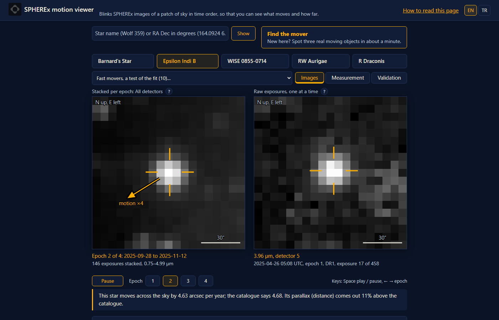
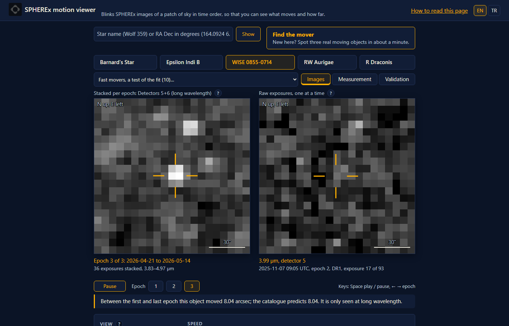
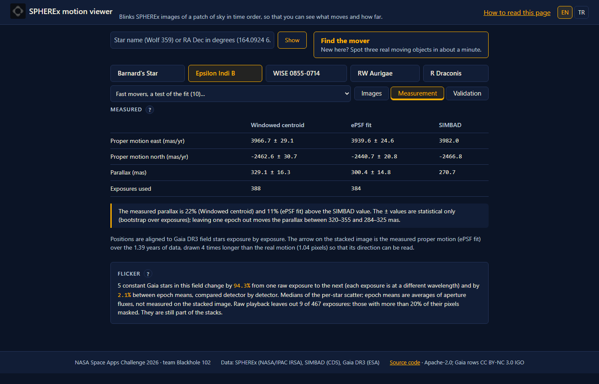
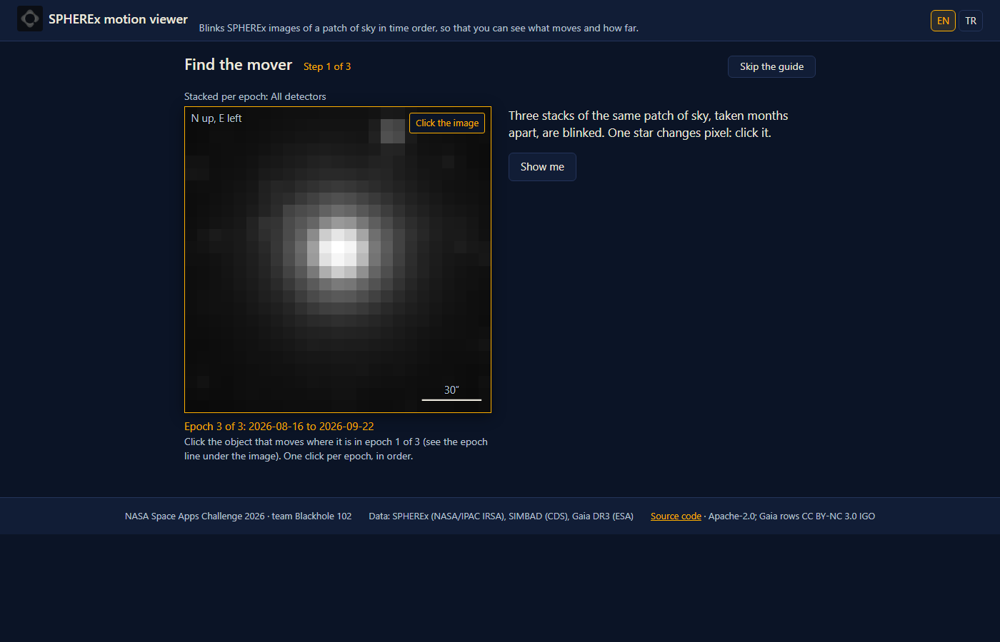
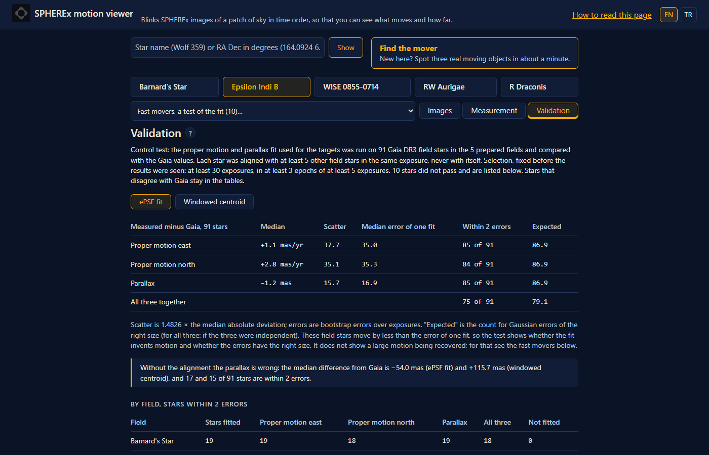
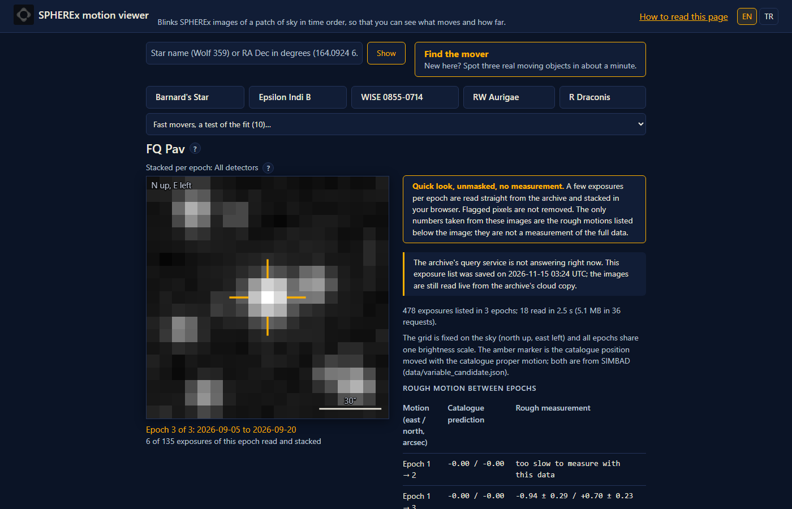
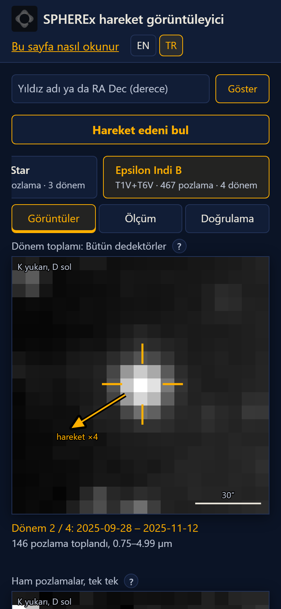

# Blackhole 102 — SPHEREx hareket görüntüleyici

[English](README.md) · **Türkçe**

NASA Space Apps Challenge 2026, "Planet X and SPHEREx" challenge'ı için hazırlandı.

SPHEREx görüntülerini zaman sırasıyla gösteren ve hareket eden cisimleri görünür
kılan, herkese açık bir web aracı. Her gözlem dönemi için tek bir toplam görüntüyü
ham pozlamaların yanında blink olarak oynatır ve görüntülerden ölçülebilenleri
katalogla karşılaştırarak verir.

**Canlı site:** https://blackhole-spherex.vercel.app (Türkçe için `?lang=tr`)

## Fikir

SPHEREx bütün gökyüzünü 102 dalga boyunda (0,75–5,0 µm) tarıyor ve her pozlama
farklı bir dalga boyunda çekiliyor. Bu, spektrum için tasarlanmış bir çalışma
biçimi; ama pozlamaları sırayla oynatınca parlaklık kareden kareye sıçrıyor ve
hareket bu titremenin içinde kayboluyor.

Araç, aynı gözlem dönemindeki bütün pozlamaları sabit bir gökyüzü ızgarasında
(kuzey yukarı, doğu sol, piksel başına 6,15 yay saniyesi) birleştiriyor. Izgara
hedefi takip etmediği için, dönemler blink edildiğinde hareket eden cisim piksel
değiştiriyor.

Epsilon Indi B alanındaki sabit Gaia yıldızlarında parlaklık değişimi ham
pozlamalar arasında %94,3, dönem toplamları arasında %2,1
(`logs/flicker_<slug>.log`).

## Sonuçlar

Bütün sayılar repodaki loglardan alınmıştır; sitede elle yazılmış sayı yoktur.

**Epsilon Indi B** (özdevinim ve paralaks fiti, Gaia alan yıldızlarına hizalanmış,
`logs/fit_motion_eps-indi-b_aligned.log`):

| | Pencereli merkez | ePSF fiti | SIMBAD |
|---|---|---|---|
| Özdevinim doğu (mas/yıl) | 3966.7 ± 29.1 | 3939.6 ± 24.6 | 3982.0 |
| Özdevinim kuzey (mas/yıl) | −2462.6 ± 30.7 | −2440.7 ± 20.8 | −2466.8 |
| Paralaks (mas) | 329.1 ± 16.3 | 300.4 ± 14.8 | 270.7 |

Toplam hareket: ölçülen 4,63, katalog 4,68 yay saniyesi/yıl.

**WISE 0855-0714**, bilinen en soğuk kahverengi cücelerden biri: yalnızca uzun
dalga boyunda (dedektör 5+6) görünüyor. Dönem 1 → 3 arasında ölçülen kayma
−7.97 ± 0.68 / +1.08 ± 0.55 yay saniyesi (doğu / kuzey), katalog tahmini
−8.01 / +0.65 (`logs/neighbour_test_wise-0855.log`).

**Doğrulama, 91 Gaia DR3 alan yıldızı** (`logs/validation_field_stars.log`):
ePSF fiti doğu özdevinimde 85, kuzeyde 84, paralaksta 85 yıldızda Gaia ile
2 hata içinde; üçü birden 75 yıldızda (doğru boyutta Gauss hatalar için
beklenen 79,1).

**Doğrulama, 10 hızlı yıldız** (`logs/fast_movers_table.log`): değerlendirilebilen
9 yıldızın 8'inde iki özdevinim bileşeni de SIMBAD ile 2 hata içinde (ePSF fiti).

## Sitede neler var

- **15 hazır hedef:** beş test hedefi (Barnard's Star, Epsilon Indi B,
  WISE 0855-0714, RW Aurigae, R Draconis) ve on hızlı yıldız.
- **Dönem toplamı ve ham pozlamalar** yan yana, dedektör seçimi, katalog konumu
  ve fark görüntüsü ipucu.
- **Üç sekme:** Görüntüler, Ölçüm, Doğrulama.
- **"Hareket edeni bul" rehberi** (`?guide=1`): üç gerçek hareketli cisimle
  bir dakikalık tanıtım.
- **Oyun modu** (`?game=1`): rastgele hedef, süre ve puan.
- **Hızlı bakış:** herhangi bir yıldız adı ya da koordinat; tarayıcı görüntü
  satırlarını SPHEREx arşivinin herkese açık bulut kopyasından doğrudan okur.
- **İngilizce ve Türkçe** metinler, "?" düğmelerinin arkasında kısa açıklamalar,
  klavye kısayolları.

| Rehber | Doğrulama sekmesi |
|---|---|
|  |  |

| Hızlı bakış | Telefon, Türkçe |
|---|---|
|  |  |

## Nasıl çalışıyor

1. **Hedefler:** konum, özdevinim ve paralaks SIMBAD'dan.
2. **Veri:** IRSA'dan SPHEREx Level-2 spektral görüntüler (`spherex_dr1`,
   `spherex_qr3`).
3. **Toplama:** 30 günden uzun arayla çekilen pozlamalar yeni bir dönem başlatır.
   Her dönem sabit ızgaraya yeniden örneklenir ve kırpılmış ortalamayla
   birleştirilir; kötü pikseller FLAGS görüntüsüyle maskelenir.
4. **Konum:** hedef ve Gaia alan yıldızları her pozlamada iki yöntemle ölçülür
   (pencereli merkez, ePSF fiti). Pozlamalar alan yıldızlarıyla hizalanır, sonra
   5 parametreli fit (konum, özdevinim, paralaks) yapılır; hatalar pozlamalar
   üzerinden bootstrap ile.
5. **Site:** Vite + React + TypeScript, Vercel'de. Hazır hedefler statik PNG ve
   JSON dosyalarıdır.

## Sınırlar

Bilinen sınırların tam listesi [İngilizce README](README.md#known-limitations)
içindedir. Özetle:

- Hatalar yalnızca istatistiksel (bootstrap).
- Barnard's Star, RW Aurigae ve R Draconis çok parlak olduğu için pozlamaların
  çoğunda doymuş; bunlar için hareket ölçümü verilmiyor.
- Hızlı bakış maskesizdir ve kaba sayılar verir. Pozlama listesini IRSA'nın
  sorgu servisinden alır; bu servis 15 Kasım 2026'da en az 12:13'ten (UTC+3)
  itibaren HTTP 502 döndü. Bu sürede FQ Pav kayıtlı listeyle açılır; hazır
  hedefler bu servise bağlı değildir.

## Veri ve kaynaklar

- SPHEREx Level-2 görüntüleri, NASA/IPAC Infrared Science Archive (IRSA)
- SIMBAD (CDS, Strasbourg), Gaia DR3 (ESA/Gaia/DPAC)
- İlham kaynağı: WISE görüntüleri için blink aracı WiseView.
- Lisans: Apache-2.0; `data/gaia/` altındaki Gaia satırları CC BY-NC 3.0 IGO.
  Ayrıntılar: [SOURCES.md](SOURCES.md).

Takım: Blackhole 102.
